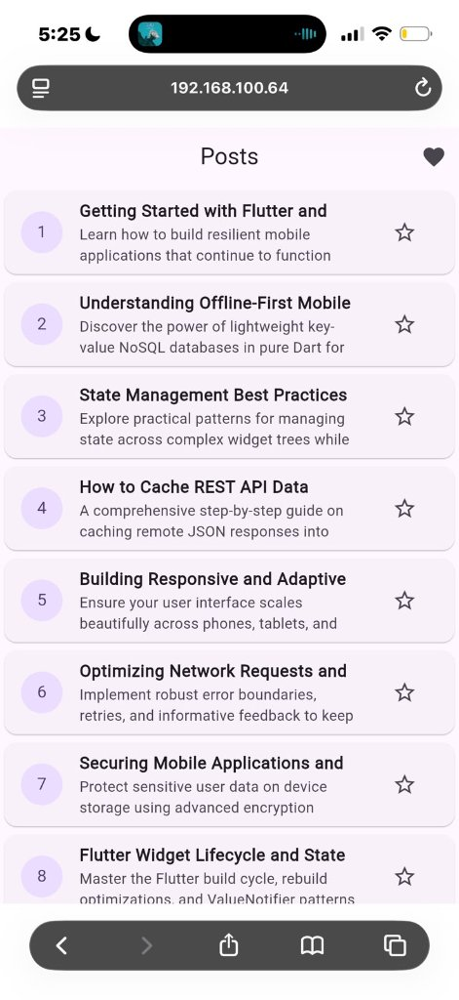
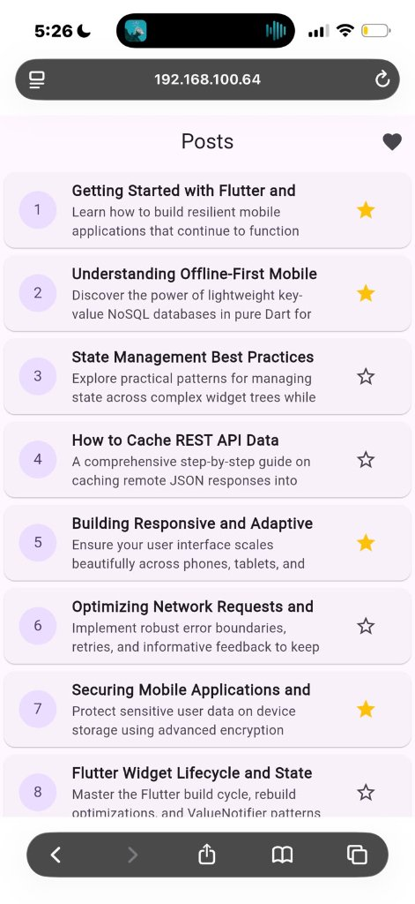
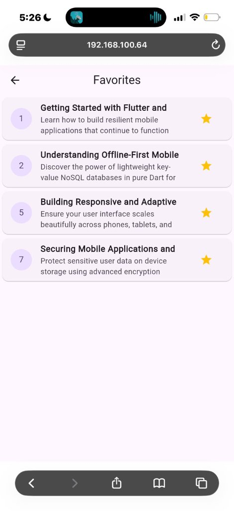
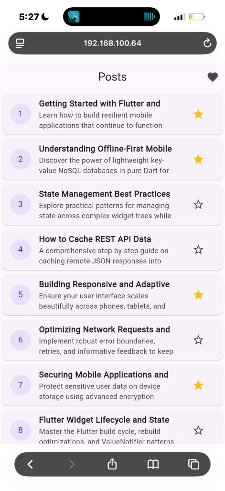
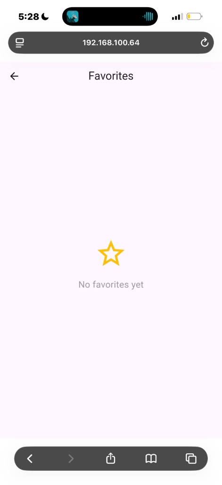

# Posts Hive App 📱📦

An offline-first Flutter application utilizing **Hive** (a lightweight, blazing-fast key-value NoSQL database written in pure Dart) for local caching and data persistence. Built as part of **Mobile Lab Section 5** with the completed **Favorites Feature Assignment**.

---

## 📑 Table of Contents
- [Overview & Objectives](#-overview--objectives)
- [Key Concepts: Hive vs Other Storage Solutions](#-key-concepts-hive-vs-other-storage-solutions)
- [Architecture & Data Flow](#-architecture--data-flow)
- [The Favorites Assignment & Critical Lab Rule](#-the-favorites-assignment--critical-lab-rule)
- [Project Directory Structure](#-project-directory-structure)
- [Getting Started & How to Run](#-getting-started--how-to-run)
- [Verification & Automated Tests](#-verification--automated-tests)
- [Offline Verification Guide](#-offline-verification-guide)
- [Submission Screenshots](#-submission-screenshots)

---

## 🎯 Overview & Objectives

In modern mobile development, network connectivity is unpredictable. Users expect apps to remain responsive and accessible even when offline or experiencing poor connectivity.

This project implements an **Offline-First Caching Architecture** with the following core objectives:
1. **Fetch Remote Data**: Consumes remote posts from the JSONPlaceholder REST API (`https://jsonplaceholder.typicode.com/posts`).
2. **Local Caching**: Caches posts locally into Hive storage (`postsBox`) whenever an internet connection is available.
3. **Seamless Offline Fallback**: Automatically serves cached posts when the device has no internet access or the network request fails.
4. **Favorites Assignment**: Allows users to mark posts as favorites with persistent storage (`favoritesBox`), an interactive favorites screen, and instant reactive state management across screens.

---

## 🧠 Key Concepts: Hive vs Other Storage Solutions

| Feature | `Hive` | `SharedPreferences` | `SQLite` / `sqflite` |
| :--- | :--- | :--- | :--- |
| **Type** | NoSQL Key-Value Store | Key-Value Store | Relational (SQL) |
| **Language & Bindings** | Pure Dart (No native overhead) | Platform-specific (Java/Obj-C/Swift via Platform Channels) | Native C libraries via Platform Channels |
| **Performance** | Extremely fast (in-memory indexes, zero IPC cost) | Slow for frequent reads/writes; runs on UI/platform thread | Moderate to fast; overhead on query parsing & IPC |
| **Data Types Supported**| Primitives + Complex Custom Objects via `TypeAdapters` | Only primitives (`int`, `String`, `bool`, `double`) | Tabular relational data with schemas |
| **Encryption** | Built-in AES-256 encryption support | None (requires third-party plugin or manual encryption) | Available via SQLCipher |
| **Use Cases** | App state, offline caching, objects, fast queries | Settings, auth tokens, small configuration flags | Complex relational data with multi-table joins |

### TypeAdapters & Code Generation
Hive serializes custom Dart classes into binary data using **TypeAdapters**. 
- Each model is decorated with `@HiveType(typeId: X)`.
- Each field to be persisted is marked with `@HiveField(index)`.
- Running `dart run build_runner build --delete-conflicting-outputs` automatically produces `post_model.g.dart`.
- The adapter must be registered via `Hive.registerAdapter(PostAdapter())` before opening any box that stores that type.

---

## 🏗️ Architecture & Data Flow

```
                      +-----------------------------+
                      |   JSONPlaceholder REST API  |
                      |     (/posts endpoint)       |
                      +--------------+--------------+
                                     |
                          HTTP GET   | (Online)
                                     v
                      +-----------------------------+
                      |         PostService         |
                      +--------------+--------------+
                                     |
               +---------------------+---------------------+
               | (Cache Response)                          | (Fallback on error)
               v                                           v
      +------------------+                        +------------------+
      |  Hive: postsBox  |                        |  Hive: postsBox  |
      |   (box.addAll)   |                        |  (box.values)    |
      +--------+---------+                        +--------+---------+
               |                                           |
               +---------------------+---------------------+
                                     |
                                     v
                        +--------------------------+
                        |       PostsScreen        |
                        |      (FutureBuilder)     |
                        +------------+-------------+
                                     |
                         Toggle Fav  | (ValueListenableBuilder)
                                     v
                        +--------------------------+
                        |     FavoritesService     |
                        | (Clones Post -> saves)   |
                        +------------+-------------+
                                     |
                                     v
                        +--------------------------+
                        |   Hive: favoritesBox     |
                        +------------+-------------+
                                     |
                                     v
                        +--------------------------+
                        |     FavoritesScreen      |
                        +--------------------------+
```

### Caching Strategy:
1. When `PostService.getPosts()` is invoked, it attempts to fetch posts from the network.
2. **If HTTP 200**:
   - `postsBox.clear()` empties previous stale data.
   - `postsBox.addAll(posts)` serializes and stores the new batch in binary format.
   - Returns the fresh network list.
3. **If Network Error / Exception / Offline**:
   - Catches the exception.
   - Checks if `postsBox.isNotEmpty`.
   - If cached posts exist, returns `postsBox.values.toList()`.
   - If no cache exists, throws an informative error (`No Internet and No Cached Data`).

---

## ⭐ The Favorites Assignment & Critical Lab Rule

### Assignment Requirements:
- **Star Icon**: Each post in `PostsScreen` displays an interactive star (`Icons.star` if favorited, `Icons.star_border` if not).
- **Favorites Screen**: An AppBar action button navigates to `FavoritesScreen`, displaying all favorited posts.
- **Unfavorite Capability**: Users can unfavorite a post from either screen.
- **Empty State**: Friendly placeholder display (`"No favorites yet"`) when no favorites have been added.
- **Reactive UI**: Real-time synchronization between screens powered by `ValueListenableBuilder<Box<Post>>` on `Hive.box<Post>('favoritesBox').listenable()`.
- **Persistence**: Favorited posts remain saved across app restarts.

### ⚠️ CRITICAL LAB RULE (HiveObject Single-Box Limitation):
> **Rule:** An instance of `HiveObject` can only belong to **ONE box** at a time.
>
> If an instance already stored in `postsBox` is saved directly to `favoritesBox` via `box.put(id, post)`, Hive throws a runtime error:
> `HiveError: The same instance cannot be stored in more than one box`.

#### Solution Implemented in `FavoritesService`:
Whenever a post is saved to `favoritesBox`, we explicitly create an independent clone of the `Post` instance:
```dart
Future<void> toggleFavorite(Post post) async {
  // CRITICAL LAB RULE: Clone instance to prevent multi-box HiveError
  final Post copy = Post(
    id: post.id,
    title: post.title,
    body: post.body,
    userId: post.userId,
  );

  if (_box.containsKey(post.id)) {
    await _box.delete(post.id);
  } else {
    await _box.put(post.id, copy);
  }
}
```

---

## 📂 Project Directory Structure

```
posts_hive_app/
├── lib/
│   ├── main.dart                  # App entry point, Hive init & box opening, routes
│   ├── models/
│   │   ├── post_model.dart        # Post entity (HiveType id:0, HiveFields 0..3)
│   │   └── post_model.g.dart      # Generated TypeAdapter (build_runner)
│   ├── services/
│   │   ├── post_service.dart      # Online API fetch + Hive postsBox caching & offline fallback
│   │   └── favorites_service.dart # Favorites CRUD with clone isolation & listenable
│   └── screens/
│       ├── posts_screen.dart      # Posts feed with pull-to-refresh & reactive star icons
│       └── favorites_screen.dart  # Favorites list with empty state & real-time removal
├── test/
│   └── widget_test.dart           # 6 automated unit tests for serialization, adapters & logic
├── pubspec.yaml                   # Dependencies (hive, hive_flutter, http, etc.)
└── README.md                      # Comprehensive lab & assignment documentation
```

---

## 🚀 Getting Started & How to Run

### 1. Prerequisites
- [Flutter SDK](https://flutter.dev/docs/get-started/install) (3.x or newer)
- Target device/simulator (iOS Simulator, Android Emulator, macOS Desktop, or Chrome)

### 2. Install Dependencies
```bash
flutter pub get
```

### 3. Generate TypeAdapters (if modifying model)
```bash
dart run build_runner build --delete-conflicting-outputs
```

### 4. Run the Application
- **On Connected iPhone or iOS Simulator:**
  ```bash
  flutter run
  ```
- **On macOS Desktop:**
  ```bash
  flutter run -d macos
  ```
- **On Web (Chrome):**
  ```bash
  flutter run -d chrome
  ```

---

## ✅ Verification & Automated Tests

### 1. Static Analysis (`flutter analyze`)
Run the static analyzer to confirm zero linter warnings or errors:
```bash
flutter analyze
# Output: No issues found!
```

### 2. Unit & Integration Tests (`flutter test`)
Run the test suite verifying serialization, Hive TypeAdapter storage, and favorites logic:
```bash
flutter test test/widget_test.dart
```

**Test Coverage Summary:**
1. `Post.fromJson`: Verifies JSON deserialization of `id`, `title`, `body`, and `userId`.
2. `Post round-trips through Hive`: Confirms binary serialization and retrieval using `PostAdapter`.
3. `isFavorite returns false`: Validates default state for unselected posts.
4. `toggleFavorite adds a post`: Validates adding a post to `favoritesBox`.
5. `toggleFavorite removes a post`: Validates removing an existing post upon second toggle.
6. `CRITICAL LAB RULE: copy isolation`: Verifies that mutating the source post does not corrupt the persisted favorite.

---

## 🧪 Offline Verification Guide

To test offline functionality and verify requirements for lab grading:

1. **Step 1 (Online Fetch):**
   - Ensure your device has an active Wi-Fi or cellular connection.
   - Launch the app. The progress indicator will display briefly, and 100 posts will populate the list from the JSONPlaceholder API.
   - Check debug logs: `Loaded from API and cached to Hive: 100`.

2. **Step 2 (Toggle Favorites):**
   - Tap the star icon on any post. The icon immediately fills with amber color.
   - Tap the favorites icon in the top right AppBar to view the `FavoritesScreen`. The selected post is listed.

3. **Step 3 (Offline Mode Simulation):**
   - Enable **Airplane Mode** or disconnect Wi-Fi.
   - Perform a pull-to-refresh swipe on the `PostsScreen` or close and relaunch the app.
   - The app continues to load and display all posts seamlessly from the local Hive `postsBox`.
   - Check debug logs: `Loaded from Hive offline: 100`.

4. **Step 4 (Restart Persistence):**
   - Force quit the application completely.
   - Reopen the app (still offline).
   - Navigate to the `FavoritesScreen` — all previously favorited posts remain intact.

---

## 📸 Submission Screenshots

| Screen | Description | iPhone Preview |
| :--- | :--- | :---: |
| **1. Online Posts Screen** | All posts fetched from API and cached in `postsBox` |  |
| **2. Favoriting Action** | Star icons reactively toggled amber on selected posts |  |
| **3. Favorites Screen** | Curated list of favorited posts stored in `favoritesBox` |  |
| **4. Offline Caching Mode** | Posts seamlessly loaded from local Hive cache |  |
| **5. Empty Favorites State** | Friendly empty placeholder when no posts are favorited |  |

---

## 👨‍💻 Author & Submission
- **Project:** Mobile Lab - Section 5 (Hive Local NoSQL Storage & Offline Caching)
- **Framework:** Flutter / Dart
- **Database:** Hive NoSQL
